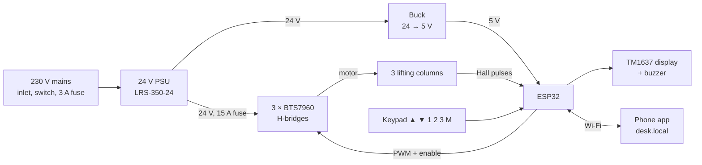

# Motorised L-Desk

A DIY sit-stand L-shaped desk built to match commercial desks: three synchronised lifting columns, a keypad with ▲/▼ and three memory presets, and a phone app that runs on the desk itself. Built in Mumbai with parts from Lamington Road and IndiaMART.

**[▶ Open the interactive 3D preview](https://mustansir-vora.github.io/motorised-l-desk/)** — rotate the desk and drive it with the same keypad logic the firmware uses.


---

## Contents

- [What it does](#what-it-does)
- [Specs](#specs)
- [Progress](#progress)
- [Repository layout](#repository-layout)
- [How it works](#how-it-works)
- [Getting started: firmware](#getting-started-firmware)
- [Using the desk](#using-the-desk)
- [Phone app and HTTP API](#phone-app-and-http-api)
- [The 3D preview (GitHub Pages)](#the-3d-preview-github-pages)
- [Parts and budget](#parts-and-budget)
- [Safety](#safety)
- [Roadmap](#roadmap)
- [License](#license)

---

## What it does

- **Hold ▲ / ▼** to move; releases soft-stop.
- **Presets 1, 2, 3** drive to a saved height and slow down over the last 25 mm.
- **Save a preset:** press **M**, then **1**, **2** or **3** within 5 s.
- **Height display** in cm on a 4-digit seven-segment display.
- **Leg sync:** each leg's Hall encoder is counted and a leg that gets ahead is slowed, so the top stays level.
- **Anti-collision:** a stalled leg or a sudden drop in speed stops the desk and reverses it 20 mm.
- **Phone app** at `http://desk.local`, served by the ESP32 — no app store, works on Android and iPhone.
- **Wireless firmware updates** over the home network.

## Specs

| Item | Value |
| --- | --- |
| Top | Right-hand L, 1600 × 1400 mm, 25 mm board, two pieces joined over the frame |
| Legs | 3 × 3-stage 24 V lifting columns with Hall sensors (left end, corner, return end) |
| Height range | about 645–1290 mm (desktop surface) |
| Speed | about 35 mm/s |
| Load | 150 kg working load (3 × 800 N columns) |
| Controller | ESP32 DevKit V1 + 3 × BTS7960 H-bridges + Mean Well LRS-350-24 |
| Interface | 6-key keypad (▲ ▼ 1 2 3 M), TM1637 display, buzzer, phone app |

## Progress

Tick these off as the build moves along. Dated notes go in [`build-log/`](build-log/README.md).

- [x] Design, dimensions and parts list ([build guide](guide/build-guide.md))
- [x] Firmware v0.1 (untested on hardware)
- [x] Phone app v0.1 (served by the firmware)
- [x] 3D preview on GitHub Pages
- [ ] Lifting columns ordered — confirm Hall voltage, output type and pulses/mm
- [ ] Electronics bought (Lamington Road) and bench-tested — Stage 1
- [ ] Frame fabricated and powder coated
- [ ] Desktop pressed, cut and edge-banded
- [ ] One leg at a time on the controller — Stage 2
- [ ] All legs, frame only, calibrated — Stage 3
- [ ] Top on, loaded, collision tests passed — Stage 4
- [ ] Cable management and final photos

## Repository layout

```
motorised-l-desk/
├── README.md                     ← you are here
├── LICENSE
├── .gitignore                    ← keeps firmware/desk_controller/secrets.h out of git
├── .github/
│   └── workflows/
│       └── firmware.yml          ← compiles the firmware on every push
│
├── docs/                         ← GitHub Pages root (the 3D preview)
│   ├── index.html                ← self-contained page; three.js from a CDN
│   └── .nojekyll                 ← serve files as-is
│
├── firmware/
│   └── desk_controller/          ← Arduino sketch (folder name must match the .ino)
│       ├── desk_controller.ino   ← control loop, sync, presets, safety, web server
│       ├── config.h              ← pins, mechanics, tuning (committed)
│       ├── secrets.example.h     ← template — copy to secrets.h
│       ├── secrets.h             ← your Wi-Fi + OTA passwords (git-ignored)
│       └── app_html.h            ← the phone app (HTML/CSS/JS in a C string)
│
├── guide/
│   └── build-guide.md            ← full build guide: design, BOM, wiring, tests
│
├── hardware/
│   ├── bom.csv                   ← parts list with live purchase status
│   ├── wiring/                   ← wiring photos, schematic exports (KiCad/Fritzing)
│   └── datasheets/               ← column datasheet, BTS7960, LRS-350 PDFs
│
├── mechanical/
│   └── drawings/                 ← fabricator drawings, cut lists, bracket hole patterns
│
└── build-log/
    ├── README.md                 ← dated progress entries, newest first
    └── photos/                   ← YYYY-MM-DD-short-name.jpg
```

**Conventions**

- Photos: `build-log/photos/2026-11-02-frame-welded.jpg` — date first so they sort.
- Datasheets: name by part, e.g. `hardware/datasheets/column-JS36DS5-3-S.pdf`.
- Keep large binaries (videos, CAD archives) under about 50 MB per file; GitHub rejects files over 100 MB. Use Git LFS if you need more.
- Commit messages: `firmware: …`, `docs: …`, `hardware: …`, `log: …` so history is easy to scan.
- Tag firmware you've flashed to the desk: `git tag fw-v0.2 && git push --tags`.

## How it works



The ESP32 runs a 50 Hz loop. Each tick it reads the three Hall counters, ramps a shared duty cycle toward the target speed, and trims each leg's duty by how far it is ahead of the average. If any two legs differ by more than 8 mm it stops with `Err1`. Positions are saved to flash when a move ends; a "moving" flag saved at the start of each move means a power cut mid-move forces a reset instead of trusting a stale height.

Full pin map, wiring rules and power budget: [build guide → Electronics](guide/build-guide.md#electronics).

## Getting started: firmware

1. Install **Arduino IDE 2**.
2. Boards Manager → install **esp32 by Espressif** (3.x).
3. Library Manager → install **TM1637Display** by Avishay Orpaz.
4. Create your secrets file:
   ```bash
   cd firmware/desk_controller
   cp secrets.example.h secrets.h
   ```
   Edit `secrets.h` with your Wi-Fi name, password and an OTA password. It is git-ignored.
5. Open `firmware/desk_controller/desk_controller.ino`, select **ESP32 Dev Module**, pick the port, upload.
6. Serial Monitor at **115200** prints the address. Open `http://desk.local` on your phone.

Later updates go over Wi-Fi: the IDE lists `desk` as a network port.

**Values to set once the columns arrive** (all in `config.h`):

| Setting | Why |
| --- | --- |
| `LEG_INVERT` | Set a leg to `true` if it moves the wrong way, instead of rewiring |
| `DEFAULT_COUNTS_PER_MM` | Placeholder; the app's two-point calibration overwrites it |
| `DEFAULT_MIN_HEIGHT_MM` / `DEFAULT_MAX_HEIGHT_MM` | Your measured bottom height and chosen top limit |
| `KP_SYNC` | Raise from 8 to 12 if one leg keeps lagging |
| `COLLISION_DROP` | Lower from 0.55 to 0.45 if heavy loads trigger false stops |
| `DUTY_MIN_MOVE` | Raise from 80 to 100 if a loaded leg hums without moving |

> If the column's Hall output swings to 5 V on its own, add a 10 kΩ / 20 kΩ divider before the ESP32 pin. 5 V can damage an ESP32 input.

## Using the desk

| Action | Keypad |
| --- | --- |
| Raise / lower | Hold ▲ / ▼ |
| Go to preset | Tap 1, 2 or 3 |
| Stop an automatic move | Any key |
| Save current height | M, then 1 / 2 / 3 within 5 s |
| Reset (find bottom, re-zero, re-level) | Hold M + ▼ for 3 s |
| Clear an error | Hold M for 3 s while `Err` shows, then reset |

| Display | Meaning |
| --- | --- |
| `72.5` | Height in cm |
| `----` | Position unknown — run a reset |
| `rSt` | Resetting |
| `S-` / `S- 1` | Waiting for a preset number / preset saved |
| `StOP` | Obstacle detected, reversing 20 mm |
| `Err1` | Legs out of step by more than 8 mm |
| `Err2` | Reset took longer than 60 s — a leg isn't sending pulses |
| `Err9` | Firmware update in progress |

## Phone app and HTTP API

The app is in `firmware/desk_controller/app_html.h` and is served by the desk. Open it, then **Add to Home Screen** for an app icon. Holding ▲/▼ sends a move every 150 ms; if the pings stop (app closed, phone locked, Wi-Fi drop) the desk stops within 0.4 s.

If `desk.local` doesn't resolve (some Android versions), reserve the desk's IP in your router and bookmark it. If home Wi-Fi is down, the desk starts a `Desk-Setup` hotspot after 20 s at `http://192.168.4.1`.

All endpoints are `GET` and return JSON state:

| Endpoint | Does |
| --- | --- |
| `/api/state` | Height, per-leg heights, mode, presets, limits, Wi-Fi strength |
| `/api/move?dir=up\|down` | Move while re-sent every ≤ 400 ms |
| `/api/stop` | Stop |
| `/api/goto?mm=1100` | Go to a height |
| `/api/preset?n=1` | Go to preset 1–3 |
| `/api/save?n=2[&mm=1080]` | Save current (or given) height to a preset |
| `/api/home` | Reset to bottom |
| `/api/clear` | Clear an error |
| `/api/calibrate?mm=728` | "The desk is now 728 mm" |
| `/api/calpoint?mm=…` | Two-point travel calibration (call twice, ≥ 200 mm apart) |
| `/api/limits?max=1250` | Set the top limit |

The API is meant for the home network only. Don't port-forward it; for remote access use something like Tailscale on an always-on machine at home.

**Editing the app:** the HTML lives between `R"HTML(` and `)HTML"` in `app_html.h`. Edit it there and re-flash. To preview while editing, copy that block into a `.html` file and open it in a browser; buttons will show "Offline" without a desk.

## The 3D preview (GitHub Pages)

`docs/index.html` is a single self-contained page (three.js r128 from cdnjs). The desk logic in it mirrors the firmware: soft start/stop, slow zone, presets, M-then-number saving, reset by holding M + ▼, and collision stop with back-off.

**Turn on Pages once:**

1. Repo → **Settings → Pages**.
2. **Source:** Deploy from a branch. **Branch:** `main`, folder **`/docs`**. Save.
3. After a minute it's live at `https://mustansir-vora.github.io/motorised-l-desk/`.

Every push to `main` that touches `docs/` redeploys it. Keyboard shortcuts on the page: arrow keys, 1, 2, 3, M.

## Parts and budget

The live parts list is [`hardware/bom.csv`](hardware/bom.csv) — update the `status` and `actual_inr` columns as you buy. GitHub renders it as a searchable table.

| Group | Estimate (₹) |
| --- | --- |
| Lifting columns × 3 | 18,000–36,000 |
| Steel frame, fabrication, powder coat | 6,600–8,600 |
| Desktop (board, laminate, edge band) | 7,600–8,600 |
| Fasteners, cable tray, spine | 2,300 |
| Electronics | 5,300–5,900 |
| **Total** | **≈ 40,000–61,000** |

Sources, shops and spec notes are in the [build guide](guide/build-guide.md#bill-of-materials--where-to-buy). Prices are October 2026 listings or estimates.

## Safety

- Anti-collision protects furniture, not fingers. Keep children and pets clear while it moves.
- All 230 V wiring stays in a closed box with the PSU earthed. Nothing at mains voltage on the perfboard.
- Fuse the 24 V rail (15 A) and the mains inlet (3 A).
- Leave slack in every cable for the full 650 mm of travel; a taut cable acts as an obstacle.
- Columns are rated around 10% duty cycle (about 2 minutes running per 20). Don't run long test loops.

## Roadmap

- [ ] Second Hall channel per leg for direction sensing
- [ ] Current sensing via the BTS7960 IS pins for a third collision check
- [ ] Home Assistant integration (MQTT or REST)
- [ ] Sit/stand reminder and daily standing-time stats in the app
- [ ] Custom PCB to replace the perfboard
- [ ] 3D-printed keypad enclosure (STL in `mechanical/`)

## License

[MIT](LICENSE) © 2026 Mustansir Saifuddin Vora. Build at your own risk: this is a mains-powered, motorised piece of furniture.
