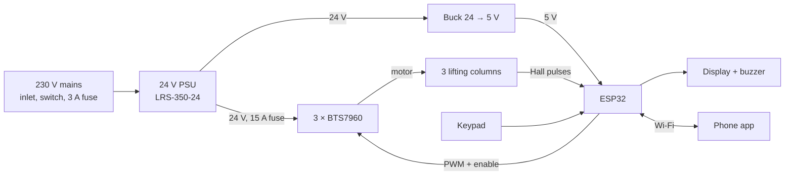

# DIY Motorised L-Shaped Standing Desk — Build Guide

*Mustansir Saifuddin Vora · first written 7 Oct 2026 · prices are October 2026 listings or estimates*

## Overview

Buy the three motorised lifting columns ready-made, build everything else yourself. The columns (telescoping steel legs with a DC motor, gearbox, lead screw and Hall-sensor encoder inside) are what make a commercial desk smooth and wobble-free, and hobby linear actuators can't match them. Everything that makes the desk *yours* — the frame, the L-top, the controller, the keypad with presets and the phone app — is a DIY job.

**Target spec (matches mid/upper-tier commercial L-desks):**

| Spec | Target |
| --- | --- |
| Legs | 3 motorised columns, 3-stage, with Hall encoders |
| Height range (top surface) | about 640–1300 mm |
| Speed | 30–38 mm/s |
| Load | 150+ kg total (3 × 70–80 kg columns) |
| Leg sync error | under 3 mm while moving |
| Noise | under 50 dB |
| Controls | Up/Down hold-to-move, 3 presets, Save (M), height display |
| Safety | Soft start/stop, anti-collision (stall detect), leg-skew cut-out, deadman stop |
| Remote | Phone app over home Wi-Fi (installable web app served by the desk itself) |

**Two ways to build it:**

1. **Path A — Full DIY controller (this guide).** Buy 3 bare lifting columns, fabricate the frame, build an ESP32 controller that drives each motor and reads each encoder. You get complete control over buttons, presets, sync and the app.
2. **Path B — Smart-up a ready frame.** Buy a complete 3-motor L-frame with its own control box and handset, then wire an ESP32 in parallel with the handset buttons (via optocouplers) for app control. Lower risk and faster, but the presets live in the vendor's box and the height reading is harder to get.

The firmware, phone app and 3D preview in this repo are written for Path A.

## Design & dimensions

The default design is a right-hand L, 1600 × 1400 mm, with three legs: one at the left end, one under the corner, one at the end of the return. Mirror every X dimension for a left-hand L. Keep each unsupported overhang under 350 mm.

| Part | Size (mm) | Notes |
| --- | --- | --- |
| Main top | 1600 long × 700 deep | Keyboard and monitors sit here |
| Return top | 700 wide × 700 long (beyond main) | Total return side = 1400 |
| Top thickness | 25 | One 8 × 4 ft board yields both pieces |
| Leg A (left end) | centre at X 150, Y 350 | Origin = back-left corner of main top |
| Leg B (corner) | centre at X 1250, Y 350 | Carries the most load |
| Leg C (return end) | centre at X 1250, Y 1250 | |
| Beam A–B | about 1000 between leg faces | Runs left to right under main top |
| Beam B–C | about 800 between leg faces | Runs front to back under return |
| Feet | 650–700 long, centred on each leg | A and B feet front-to-back, C foot left-to-right |

**Heights.** A 3-stage column retracts to about 600–620 mm and strokes 650 mm. With a 20 mm top bracket and 25 mm top, the surface runs from about 645 to 1295 mm. That covers seated users from about 150 cm tall to standing users up to about 195 cm.

**Starting presets** (refine with a tape measure on day one):

| Preset | Typical height (mm) | How to set it |
| --- | --- | --- |
| 1 — Sit | 720–750 | Seated, elbows at 90°, forearms level with the top |
| 2 — Stand | 1050–1150 | Standing in your usual shoes, same elbow rule |
| 3 — Perch / drafting | 900–950 | Stool, or your second-favourite stand height |

**Weight budget.** Top about 25 kg, frame about 15 kg, three columns about 20 kg. Three 800 N columns give roughly 240 kg of lift, so 150 kg of monitors, PC and books leaves a healthy margin.

## Bill of materials & where to buy

The lifting columns are the only part you can't walk into a Lamington Road shop and buy; everything electronic is available there or on IndiaMART the same week. The live list with purchase status is [`hardware/bom.csv`](../hardware/bom.csv).

### Motion hardware (the critical part)

| Item | Spec to ask for | Where | Price |
| --- | --- | --- | --- |
| Lifting column × 3 | 3-stage, 24 V DC, built-in Hall sensors (2 channels), 650 mm stroke, 800 N+, internal limit switches. Same model for all three. | (1) [Ergologic, Parel, Mumbai](https://m.indiamart.com/ergologic/height-adjustable-desk-frame.html) — ask for spare legs. (2) Alibaba: Jiecang [JS36DS5-3-S](https://www.directindustry.com/prod/jiecang-linear-motion/product-233233-2339077.html), Kuangshan [JC35ER-3](https://www.directindustry.com/product-manufacturer/kuangshan-dc-lifting-column-251572-127620.html), TiMOTION [TL4S](https://www.directindustry.com/prod/timotion-europe/product-126233-2468765.html) class. (3) Ewellix via [N Gen Automation, Pune](https://m.indiamart.com/n-gen-automation/lifting-column.html) — industrial, overkill. | approx. ₹6,000–12,000 each landed (Ewellix lists at ₹50,000) |
| Complete 3-motor L-frame (Path B only) | Triple motor, 90°, 3-stage | [Ergologic triple-motor 90° frame](https://dir.indiamart.com/chennai/adjustable-workstations.html), 640–1290 mm | ₹55,000 listed |

Before paying for columns, get the wiring diagram: motor wires, Hall supply voltage (5 V or 12 V), Hall output type (open-collector or push-pull), and counts per mm. Ask for the mating connector or an extension cable for each.

### Frame & top

| Item | Spec | Where | Price |
| --- | --- | --- | --- |
| Crossbeams | MS rectangular tube 60 × 30 × 2 mm, about 2.2 m total | Any steel fabricator; Lohar Chawl for stock | approx. ₹1,500 |
| Feet × 3 | MS tube 60 × 30 × 2 mm, 680 mm long, end caps | Fabricator | approx. ₹900 |
| Leg top brackets × 3 | 5 mm MS plate, 140 × 140 mm, drilled to the column's bolt pattern | Fabricator | approx. ₹1,200 |
| Fabrication + powder coat | Weld beams to brackets, matt graphite or white | Local fabricator | approx. ₹3,000–5,000 |
| Desktop board | 25 mm block board or BWR plywood, 8 × 4 ft | [25 mm BWP block board](https://m.indiamart.com/proddetail/25mm-siamply-invent-club-111-bwp-block-board-2858068550791.html) at ₹167/sq ft; MR/BWR is fine indoors and cheaper | about ₹5,300 |
| Laminate | 1 mm on top + 0.8 mm balancer underneath (prevents warping) | Any laminate dealer | approx. ₹2,000–3,000 |
| Edge band | 2 mm PVC, about 7 m | Laminate dealer | approx. ₹300 |
| Fasteners | M6 × 16 bolts + M6 threaded inserts, M8 bolts, 6 × M8 levelling glides | Lohar Chawl / hardware store | approx. ₹800 |
| Cable tray + vertical spine | Under-desk tray 600–800 mm, flexible spine | Amazon / office suppliers | approx. ₹1,500 |

### Electronics (Lamington Road / IndiaMART / online)

| Item | Qty | Spec | Where | Price each |
| --- | --- | --- | --- | --- |
| ESP32 DevKit V1 (WROOM-32, 38-pin) | 1 | Wi-Fi + Bluetooth MCU | [G D Components, Lamington Road](https://m.indiamart.com/gdcomponents/wifi-module.html) | ₹350 |
| BTS7960 (IBT-2) H-bridge | 3 | 6–27 V, 43 A, 3.3 V logic OK, 20 kHz PWM | [Thingbits](https://thingbits.in/products/bts7960-43a-h-bridge-motor-driver), [Hubtronics](https://hubtronics.in/development-boards/peripheral-modules/bts7960-motor-driver-module), Lamington Road | ₹251–443 |
| 24 V power supply | 1 | Mean Well LRS-350-24 (24 V, 14.6 A) | [Vikash Electricals](https://m.indiamart.com/vikash-electricals/smps.html), [Probots](https://probots.co.in/smps-metal-power-supply-24v-14-6a-350-4w-lrs-350-24-mean-well.html) | ₹1,900 listed |
| Buck converter | 1 | LM2596 or XL4015, 24 V → 5 V, 3 A | Lamington Road | approx. ₹120 |
| 4-digit display | 1 | TM1637, 0.56", red or amber | Lamington Road | approx. ₹100 |
| Push buttons | 6 | 12 mm momentary, printed caps (▲ ▼ 1 2 3 M) | Lamington Road | approx. ₹40 |
| Active 5 V buzzer + BC547 + 1 kΩ | 1 set | Key click and confirmation beeps | Lamington Road | approx. ₹30 |
| Resistors | — | 10 kΩ × 5, 4.7 kΩ × 3, 20 kΩ × 3 | Lamington Road | ₹50 total |
| Capacitor | 1 | 1000 µF 35 V across the 24 V bus | Lamington Road | approx. ₹40 |
| Fuses | 2 | 15 A blade fuse + holder on 24 V; IEC inlet with switch + 3 A fuse | Lamington Road | approx. ₹300 |
| Leg connectors | 3 pairs | GX16 6-pin aviation connectors | Lamington Road | approx. ₹100 |
| Enclosures | 2 | ABS box about 200 × 120 × 75; slim box or 3D print for keypad | Lamington Road | approx. ₹600 total |
| Wire | — | 18 AWG motor, 8-core 24 AWG signal | Lamington Road | approx. ₹500 |

**Shops to start with on Lamington Road:** G D Components and Ramesh Electronics (New Hanuman Building, Shamrao Vitthal Marg), Visha Electronics (Ganesh Bhavan, opposite the police station), New Silikon Electronics (ESP32, displays, power modules). Chunam Lane has the semiconductor stockists. Fake components are common, so buy the Mean Well supply from an authorised dealer and bench-test every module. Online fallback: Robu, Probots, Thingbits, Hubtronics.

### Tools

Soldering iron, multimeter, drill with 8 mm and 10 mm bits, countersink, router or track saw (or have the laminate dealer cut and edge-band), spirit level, 4 mm and 5 mm hex keys, tape measure.

## Mechanical build

Wobble is what separates a good desk from a cheap one, so the frame is welded everywhere except the leg joints. Take a column to the fabricator so brackets are drilled to the real bolt pattern.

**Frame**

1. Bench-test all three columns: 24 V across the motor wires runs each one up; reverse polarity runs it down. Note which wire colour does what.
2. Weld a 5 mm top plate for each leg, then beam A–B between plates A and B, and beam B–C between plates B and C at exactly 90°. Check the diagonal: plate A centre to plate C centre should measure about 1421 mm.
3. Add two short 60 × 30 tabs on each beam, with 7 mm holes, for screwing into the top.
4. Make the three feet with welded end caps and two M8 nuts each for levelling glides. Drill each foot to the column's base bolt pattern.
5. Powder coat everything. Matt finishes hide scratches better.

**Desktop**

1. Have the laminate dealer press 1 mm laminate on top and a balancer underneath, then cut two pieces from the 8 × 4 ft board: 1600 × 700 main and 700 × 700 return (side by side they need 2300 × 700, which fits). A one-piece L is 1400 mm deep and won't fit a 1220 mm sheet. Join the pieces with 8 mm dowels and glue, then screw two 3 mm steel mending plates under the seam; beam B–C crosses the seam and backs it up.
2. Round the three exposed outer corners to a 20 mm radius, and edge-band every edge except the two faces that meet at the seam.
3. Optional: a 60 mm grommet hole at the back of the corner for cables.

**Assembly**

1. Lay the top face-down on a blanket. Place the frame on it with a 25 mm reveal at the back edge.
2. Drill 10 mm holes 18 mm deep and fit M6 threaded inserts. Never use wood screws into the column plates.
3. Bolt each column to its top plate, motor house facing inward.
4. Bolt each foot to its column. Fit the levelling glides.
5. Mount the controller box under the main top near leg B, and the keypad at the front edge where your right hand falls when seated.
6. With two people, flip the desk upright. Never lift by the top alone with the legs extended.
7. Level with a spirit level using the glides. Route leg cables up the cable spine into the tray.

Legs must start at the same physical height before the first powered move. Run each to its bottom limit with the 24 V bench test before connecting the controller.

## Electronics

One ESP32 drives each leg through its own H-bridge and counts each leg's Hall pulses, which is what lets it keep the legs level and stop on an obstacle.

### Pin map (matches `firmware/desk_controller/config.h`)

| ESP32 pin | Connects to | Notes |
| --- | --- | --- |
| GPIO 13 | R_EN + L_EN on all three BTS7960 | 10 kΩ pull-down keeps drivers off during boot |
| GPIO 25 / 26 | Leg A RPWM / LPWM | 20 kHz PWM |
| GPIO 27 / 14 | Leg B RPWM / LPWM | |
| GPIO 32 / 33 | Leg C RPWM / LPWM | |
| GPIO 18 / 19 / 23 | Hall A of legs A / B / C | Internal pull-up plus 4.7 kΩ to 3.3 V |
| GPIO 4 / 16 / 17 | Up / Down / Preset 1 | Other side of button to GND |
| GPIO 35 / 36 / 39 | Preset 2 / Preset 3 / M | Input-only: add 10 kΩ pull-up to 3.3 V each |
| GPIO 21 / 22 | TM1637 CLK / DIO | Display VCC from 5 V |
| GPIO 5 | BC547 base via 1 kΩ | Switches the active 5 V buzzer |
| VIN / GND | 5 V buck output | Common ground with everything |

### Wiring rules

- **Power path:** mains → IEC inlet with switch and 3 A fuse → PSU. PSU +24 V → 15 A blade fuse → terminal block feeding B+ of each BTS7960 and the buck. Put the 1000 µF capacitor across that block. 18 AWG for motor current.
- **Drivers:** each BTS7960's M+ / M− go to that leg's motor. Driver logic VCC takes 5 V; inputs accept the ESP32's 3.3 V signals.
- **Hall sensors:** power from 5 V (or per datasheet). If the output swings to 5 V by itself it's push-pull: add a 10 kΩ / 20 kΩ divider. If it only pulls low, the pull-up to 3.3 V is enough.
- **Grounds:** PSU −, driver GND, buck GND, ESP32 GND and Hall GND tie at one point.
- **Mains safety:** PSU live terminals inside a closed box, PSU earth to mains earth, nothing at 230 V on the perfboard.
- **Direction check:** if a leg moves down when commanded up, swap its motor wires or set `LEG_INVERT` for it in `config.h`.

Power budget: each column draws about 2–4 A under load, so three need 6–12 A at 24 V. The LRS-350-24 gives 14.6 A. Its fan is audible; a fanless LRS-200-24 (8.8 A) works if the columns draw 2.5 A or less.

## Firmware & control logic

The firmware in `firmware/desk_controller/` runs a 50 Hz control loop that ramps the motors, keeps the legs within a few millimetres of each other, and stops on anything unexpected.

**Install:** Arduino IDE 2 → Boards Manager → "esp32 by Espressif" (3.x) → Library Manager → "TM1637Display" by Avishay Orpaz. Copy `secrets.example.h` to `secrets.h` and fill in Wi-Fi and OTA passwords. Choose "ESP32 Dev Module" and upload. Later updates go over Wi-Fi (`desk` appears as a network port).

| Feature | What the firmware does |
| --- | --- |
| ▲ / ▼ hold-to-move | Moves while held, soft-stops on release. Opposite key while moving stops first, then reverses. |
| Presets 1 / 2 / 3 | Drives to the stored height, decelerates over the last 25 mm, stops within about 1.5 mm. Any key stops it. |
| Save a preset | M (display `S-`), then 1, 2 or 3 within 5 s. Two beeps and `S- 1` confirm. Survives power cuts. |
| Height display | Desktop height in cm, e.g. `72.5`. `----` = position unknown. |
| Soft start / stop | Ramps up over about 0.65 s, down over about 0.16 s. |
| Leg sync | A leg ahead of the average is slowed by 8 duty steps per mm of lead. Cruise duty stays below 100% for headroom. |
| Skew cut-out | Legs more than 8 mm apart → all motors stop, `Err1`. |
| Anti-collision | Powered leg with no pulses for 250 ms, or speed below 55% of cruise for 60 ms → stop, `StOP`, three beeps, reverse 20 mm. |
| Soft limits | Stops 1 mm above bottom and at your max height; column limit switches are a backup. |
| Reset (homing) | Hold M + ▼ for 3 s. Legs lower slowly to their bottom switches, then counters zero and legs are re-levelled. |
| Power-loss safety | A "moving" flag is saved during motion. Power lost mid-move → boots showing `----` and asks for a reset. |
| App deadman | Phone must re-send moves every 150 ms; if it stops, the desk stops within 0.4 s. |
| Clear an error | Hold M for 3 s while `Err` shows, then reset. |

**Error codes:** `Err1` legs out of step (check Hall wiring, then reset) · `Err2` reset took over 60 s (a leg isn't sending pulses) · `Err9` firmware update in progress.

**Tuning:** if one leg lags, raise `KP_SYNC` 8 → 12. False `StOP` with heavy loads, lower `COLLISION_DROP` 0.55 → 0.45. A loaded column hums without moving, raise `DUTY_MIN_MOVE` 80 → 100.

## Phone app

The ESP32 serves the app at `http://desk.local`. Open it once, then "Add to Home Screen" (Chrome menu on Android, Share sheet on iPhone).

- Live height on an amber seven-segment display, plus a bar per leg to watch sync.
- ▲ / ▼ hold-to-move with deadman. Letting go, switching apps or locking the phone stops the desk.
- Presets: tap to go, hold 0.7 s to save (phone vibrates).
- Stop button during automatic moves.
- Settings: reset, clear error, enter measured height, two-point travel calibration, edit presets, set top limit.

If `desk.local` doesn't open, reserve the desk's IP in your router and bookmark it. With home Wi-Fi down, the desk starts a `Desk-Setup` hotspot after 20 s at `http://192.168.4.1`. The app is home-network only by design; for remote access use Tailscale on an always-on machine rather than port-forwarding.

## Calibration, testing & safety

Bring the desk up in stages, one leg at a time, top off at first. Most DIY failures are one reversed motor fighting the other two.

**Stage 1 — bench (no legs)**

- [ ] Buck set to 5.0 V before connecting the ESP32
- [ ] ESP32 boots, display `----`, one beep, serial monitor prints the address
- [ ] Phone app opens and shows "Connected"
- [ ] Each button beeps; M shows `S-`
- [ ] Multimeter on each driver's M+/M−: ▲ gives +24 V, ▼ gives −24 V

**Stage 2 — one leg at a time (top off)**

- [ ] Leg A only. Briefly press ▲: leg rises. If it lowers, swap motor wires or set `LEG_INVERT`
- [ ] App leg bar for A moves the right way. No movement = Hall wiring problem
- [ ] Repeat for B and C. With one leg connected, each move stops after about 0.75 s with `StOP` because the unplugged legs send no pulses — that's the stall check working

**Stage 3 — all legs, frame only**

- [ ] Hold M + ▼ for 3 s; all legs reach the bottom and the display shows min height
- [ ] Measure the height and enter it in Settings → Measured height
- [ ] Two-point calibration ≥ 200 mm apart; pulses/mm typically 5–30
- [ ] Full travel up: legs level within 2–3 mm on a spirit level

**Stage 4 — top on, loaded**

- [ ] Full up/down run with monitors and PC on
- [ ] Obstacle going down: 10 cm box under the front edge → stops and backs off 20 mm
- [ ] Obstacle going up: desk touching a firmly held board → stops
- [ ] Unplug mid-move, replug: shows `----` until reset
- [ ] Close the app while holding ▲: stops within half a second
- [ ] Save presets 1–3 at measured sit, stand and perch heights

**Safety rules**

- Anti-collision protects furniture, not fingers. Keep children and pets clear; never leave it moving unattended.
- Leave 30 mm clearance above the top at max height; keep cables slack for full travel.
- Columns are rated about 10% duty cycle (2 minutes running per 20).
- All 230 V wiring in the sealed PSU box with earth connected.

## Budget & shopping plan

| Group | Path A (full DIY) | Path B (smart-up a ready frame) |
| --- | --- | --- |
| Lifting columns / frame | ₹18,000–36,000 | ₹55,000 |
| Steel frame, fabrication, powder coat | ₹6,600–8,600 | — |
| Desktop | ₹7,600–8,600 | ₹7,600–8,600 |
| Fasteners, cable tray, spine | ₹2,300 | ₹2,300 |
| Electronics | ₹5,300–5,900 | about ₹1,500 |
| **Total** | **₹39,800–61,400** | **about ₹66,000–67,000** |

**Order of purchase**

1. **Columns first** — longest lead time (2–5 weeks if imported), and every bracket is drilled to them.
2. **One Lamington Road trip** for electronics while the columns ship; run Stage 1 at home.
3. **Fabricator**, with one column in hand.
4. **Laminate dealer** to press, cut and edge-band.
5. Assemble, then the test stages.

### Sources

- IndiaMART: [Ergologic frames](https://m.indiamart.com/ergologic/height-adjustable-desk-frame.html), [adjustable workstation listings](https://dir.indiamart.com/chennai/adjustable-workstations.html), [N Gen Automation columns](https://m.indiamart.com/n-gen-automation/lifting-column.html), [G D Components ESP32](https://m.indiamart.com/gdcomponents/wifi-module.html), [Vikash Electricals Mean Well](https://m.indiamart.com/vikash-electricals/smps.html), [25 mm BWP block board](https://m.indiamart.com/proddetail/25mm-siamply-invent-club-111-bwp-block-board-2858068550791.html)
- Online: [Thingbits BTS7960](https://thingbits.in/products/bts7960-43a-h-bridge-motor-driver), [Hubtronics BTS7960](https://hubtronics.in/development-boards/peripheral-modules/bts7960-motor-driver-module), [Probots LRS-350-24](https://probots.co.in/smps-metal-power-supply-24v-14-6a-350-4w-lrs-350-24-mean-well.html)
- Column specs: [Jiecang JS36DS5-3-S](https://www.directindustry.com/prod/jiecang-linear-motion/product-233233-2339077.html), [TiMOTION TL4S](https://www.directindustry.com/prod/timotion-europe/product-126233-2468765.html), [Kuangshan JC35ER-3](https://www.directindustry.com/product-manufacturer/kuangshan-dc-lifting-column-251572-127620.html), [Progressive Automations LG-02 duty cycle](https://www.progressiveautomations.com/products/lg-02)
- Lamington Road shops: [HiFiVision forum thread](https://www.hifivision.com/threads/where-to-buy-genuine-components-at-lamington-road.76502)
